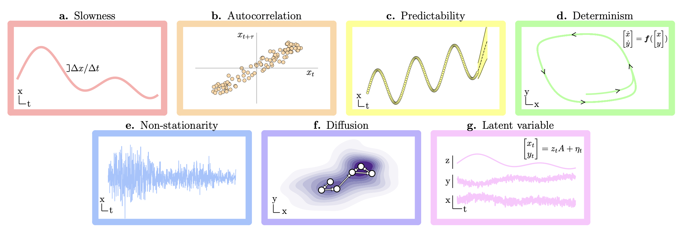
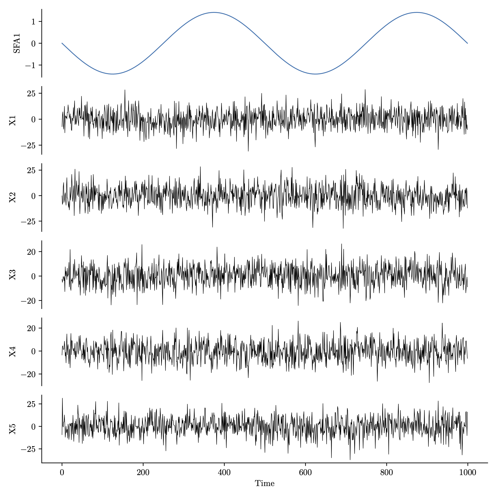

<h1 align="center"><em>tsdr</em>: Time-Series Dimension Reduction</h1>

<p align="center"></p>

<p align="center">
  <a href="https://doi.org/10.36227/techrxiv.176409662.29359239/v1"></a>
  <a href="https://pypi.org/project/tsdr/"></a>
  <a href="https://opensource.org/licenses/MIT"></a>
</p>

_tsdr_ is a Python package of time-series dimension reduction (TSDR) methods: algorithms that reduce multivariate data to a few components by exploiting temporal structure.
In contrast to general dimension reduction (GDR) methods, whose outputs are invariant to temporal permutation, TSDR methods are sensitive to temporal structure.
The package implements 29 methods from the seven categories of TSDR methods defined in [Owens & Fulcher (2025)](https://doi.org/10.36227/techrxiv.176409662.29359239/v1), written in a simple, readable style to help time-series analysts understand the algorithms discussed in that review.

## Installation

```bash
pip install tsdr
```

The package is on [PyPI](https://pypi.org/project/tsdr/) and requires Python 3.8 or later.
It depends on `numpy`, `scipy`, `scikit-learn`, `pywavelets` and `kneed`.
The example below also uses `matplotlib`.

## Quick start

Every method is a class with a scikit-learn-style `fit`, `transform` and `fit_transform`.
Here we extract a slow sinusoid from a linear mixture of noise channels using slow feature analysis (SFA):

```python
from tsdr.slowness import SFA

import numpy as np
import scipy
import matplotlib.pyplot as plt

# create a dataset for analysis
# a sinusoid
z = np.sin(np.linspace(0, 4*np.pi, 1000))
# multichannel noise
D = 5
noise = np.random.normal(scale=1.0, size=((len(z), D-1)))
# linear mixing
A = scipy.stats.ortho_group.rvs(D, random_state=1)
X = np.concatenate([z.reshape(-1,1), noise], axis=1) @ A

# extract a slow component using SFA
slow_component = SFA(n_components=1).fit_transform(X)

# visualize the component
fig, axs = plt.subplots(6, 1, figsize=(8, 8))
axs[0].plot(slow_component, lw=1.0)
axs[0].set_ylabel('SFA1')
for i in range(D):
    axs[i].spines[['right', 'top', 'bottom']].set_visible(False)
    axs[i].set_xticks([])
    axs[i+1].plot(X[:, i], c='black', linewidth=0.5)
    axs[i+1].set_ylabel(f'X{i+1}')
axs[D].spines[['right', 'top']].set_visible(False)
axs[D].set_xlabel('Time')
plt.tight_layout()
```

<p align="center"></p>

## Available methods

The methods are grouped by the aspect of temporal structure that they exploit.
Each is imported from the module named in the first column, e.g., `from tsdr.slowness import SFA`.

| Category | Module | Methods |
|---|---|---|
| (a) Slowness | `tsdr.slowness` | `SFA` (slow feature analysis), `BioSFA` (biologically plausible SFA), `ISFA` (independent slow feature analysis), `SICA` (slow independent component analysis) |
| (b) Autocorrelation | `tsdr.autocorrelation` | `TICA` (time-lagged independent component analysis), `TMCA` (time-lagged maximum covariance analysis), `CSA` (colored subspace analysis), `TCCA_Stiefel` (time-lagged canonical component analysis by trace optimization on the Stiefel manifold), `sPCA_dwt` (spectral PCA using the discrete wavelet transform) |
| (c) Predictability | `tsdr.predictability` | `TLPC` (temporally local predictive coding), `PrCA` (predictable component analysis), `DiCCA` (dynamic inner canonical correlation analysis), `ForeCA` (forecastable component analysis), `PFA` (predictable feature analysis), `PTS` (principal time series), `DCA` (dynamical components analysis) |
| (d) Determinism | `tsdr.determinism` | `DyCA` (dynamical component analysis), `DMD` (dynamic mode decomposition) |
| (e) Non-stationarity | `tsdr.nonstationarity` | `ASSA` (analytic stationary subspace analysis), `SSAsir`, `SSAsave`, `SSAcor` (stationary subspace analysis via sliced inverse regression, sliced average variance estimation, and time-lagged autocorrelation), `WaSSAf`, `WaSSAr` (Wasserstein stationary subspace analysis using the Fréchet and root-Fréchet means), `BSSnonstat` (blind source separation via non-stationarity of variances) |
| (f) Diffusion | `tsdr.diffusion` | `DMcov` (diffusion maps using covariance distance), `DIG` (dynamical information geometry) |
| (g) Latent variable | `tsdr.latentvariable` | `LDS` (latent linear dynamical system), `DFA` (dynamic factor analysis) |

The figure at the top summarizes these categories.

A few methods differ from the common pattern:

- Methods with a random initialization or random order of updates (`BioSFA`, `ISFA`, `SICA`, `ForeCA`, `DCA`, `BSSnonstat`, `LDS`, `DFA`) accept a `random_state` argument for reproducible results; `TCCA_Stiefel` uses a `seed` argument.
- The diffusion methods (`DMcov`, `DIG`) embed sliding windows of the time series (of length `window`, every `step` samples) rather than individual time points, so `fit_transform` returns one row per window and there is no separate `transform`.

## Citation

If you use this software, please read and cite the open-access article:

> Owens, K. S. & Fulcher, B. D. (2025). Time-series dimension reduction: a comprehensive review and conceptual unification of algorithms. _TechRxiv_. [doi:10.36227/techrxiv.176409662.29359239/v1](https://doi.org/10.36227/techrxiv.176409662.29359239/v1)

```bibtex
@article{owens2025tsdr,
  title   = {Time-series dimension reduction: a comprehensive review and conceptual unification of algorithms},
  author  = {Owens, Kieran S. and Fulcher, Ben D.},
  journal = {TechRxiv},
  year    = {2025},
  doi     = {10.36227/techrxiv.176409662.29359239/v1}
}
```

## License

_tsdr_ is released under the [MIT License](LICENSE.txt).
